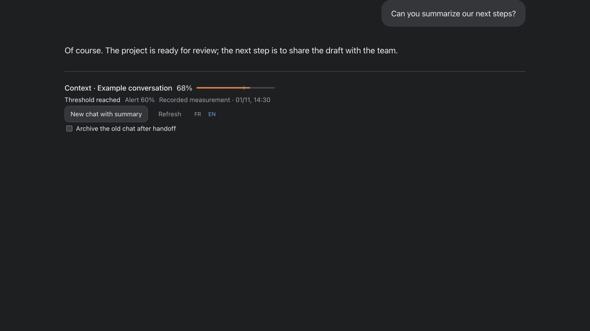
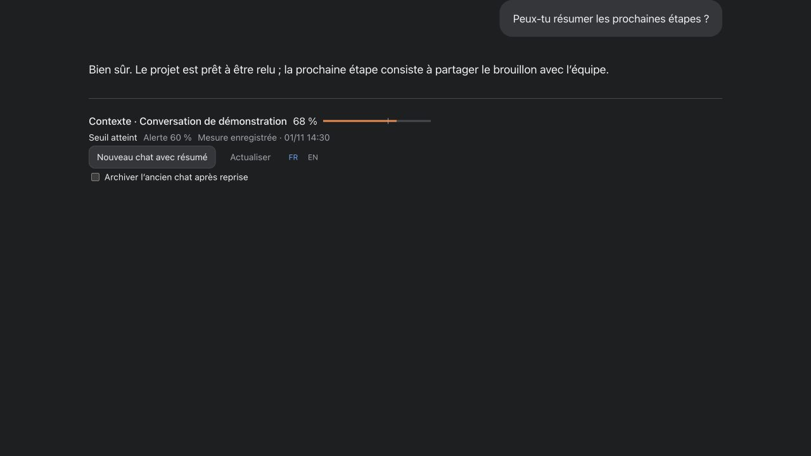

# Codex Context Weather

[Français](README.md) · English

Created by **[ALK Graphic](https://www.alkgraphic.com)**, in Antibes, France.

### Start fresh with a lighter context, without losing the thread.

**When a conversation gets too long, Codex Context Weather helps you start a new chat with a lighter context, without having to explain everything again.**

As a discussion grows, useful information can become buried in earlier exchanges, and some details may be summarized or missed. The gauge helps you decide when to hand over; a summary gathers the important points so you can continue with more clarity.

The package combines an alert, a discreet gauge and a handoff workflow. The summary aims to retain the objective, decisions, verified results, work in progress and authorization boundaries.

Starting a new chat does not erase the old one, and a summary is no substitute for checking facts. This approach helps organize continuity; it cannot guarantee that the assistant will never make mistakes or miss a detail.

> **Local prototype.** Inline rendering, hooks and native Codex capabilities depend on the environment and available permissions. Installation alone does not prove that they are active or visible.

## At a glance



*Screenshot of a local demonstration using a fictional conversation and sample measurements.*

| Feature | Purpose |
| --- | --- |
| Context gauge | Shows the latest recorded measurement for the selected conversation, with a color indicator. |
| Configurable threshold | Raises an alert at the chosen level; the suggested default is 60%. |
| French / English | Changes the display language and related requests. |
| On-demand refresh | Requests a new reading; the gauge remains a dated snapshot, not a live counter. |
| New chat with summary | Asks the assistant to prepare a handoff and create one conversation in the same project, if tools and permissions allow it. |
| Optional archiving | Offers to archive the old chat after the handoff is confirmed. The option is unchecked by default; automations are not moved. |

## A handoff, step by step

1. The gauge shows the latest measured context usage and your threshold.
2. When you choose, request a new chat with a summary. You can choose to archive the old one after the handoff is verified.
3. The assistant prepares a focused summary: objective, decisions, verified results, remaining work, boundaries and ongoing operations.
4. It verifies the project and creates one local chat, then checks that the summary was received. The source chat and its automations remain in place, unless you explicitly request archiving of the chat.



The button submits a request: **the gauge itself does not create the chat**. Depending on your environment, Codex may ask for confirmation or refuse the action, particularly when the summary contains private information. The assistant should explain the block and wait for any required authorization or intervention. It should also report an unknown outcome without blindly retrying.

## A clear measurement, without a live-update claim

The counter uses the native metadata available for the chat’s latest measurement: the number of tokens used divided by the context window. It does not represent cumulative conversation usage. If the data is unavailable or its format changes, the result should be reported as unavailable.

The gauge is a **timestamped snapshot**: it does not continually poll the local server. A hook can report a threshold at the next supported event; it does not monitor an idle chat and does not render the gauge by itself.

## Installation and configuration

Requirements: Python 3.9 or later and a POSIX system with `fcntl` (macOS or Linux). The package requires no additional Python modules.

**Compatibility to verify:** the project was developed and tried on an Intel Mac. It has not yet been verified on Apple Silicon Macs; testing is needed before compatibility can be guaranteed.

```bash
python3 install.py --threshold 60 --action prepare
```

The configuration lets you choose the threshold, alert language and desired behavior. After installation, review and approve the package’s three hooks in Codex’s native interface if prompted. An unapproved hook remains inactive; also verify loading in existing chats.

```bash
python3 ~/.codex/skills/contexte-reprise-projet/scripts/configure.py --threshold 70 --action prepare --language en
```

Available actions are `notify`, `prepare`, `compact`, `new-chat` and `compact-and-new-chat`. This setting describes a workflow: it does not, by itself, authorize an action or cause the hook to create a chat automatically.

## Context and limitations

- The counter is calculated locally and does not require a model call or paid service.
- The component reads context metadata; a public package must exclude raw conversations, secrets and private backups.
- Tests using fictional data do not prove that Codex displayed a notification or performed a native action; verify these separately.
- Native transcript formats and available tools can change. Archiving and handoff remain subject to the environment’s checks and permissions.
- A separate local panel is optional; the inline gauge is a different presentation and does not require a permanent server.

## Check the package

```bash
python3 -m unittest discover -s tests -v
```

Before distribution, check that the source package matches the version described here, and exclude personal settings, logs, conversations, summaries and private backups.

---

*Work in progress: compatibility of the latest changes must still be verified before publication.*
