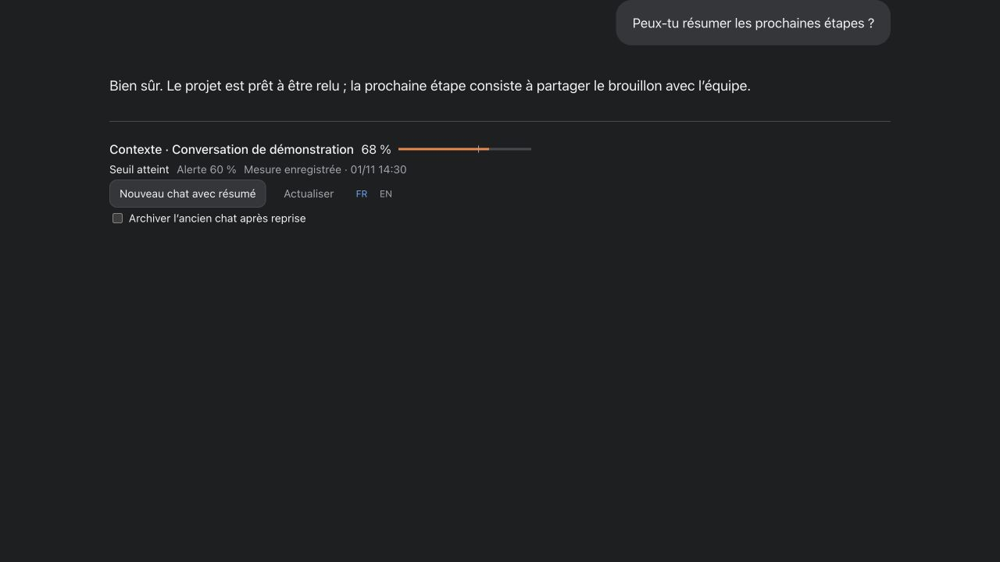
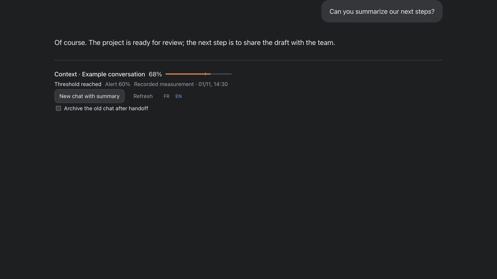

# Codex Context Weather

[English](README.en.md) · Français

Créé par **[ALK Graphic](https://www.alkgraphic.com)**, à Antibes, France.

### Repartez avec un contexte plus léger, sans perdre le fil.

**Quand une conversation devient trop longue, Codex Context Weather vous aide à repartir dans un nouveau chat avec un contexte plus léger, sans devoir tout réexpliquer.**

Au fil d’une longue discussion, les informations utiles se mêlent aux échanges anciens et certains éléments peuvent être résumés ou oubliés. La jauge aide à repérer le moment de passer le relais ; une synthèse rassemble les points importants pour poursuivre plus sereinement.

Le paquet associe une alerte à une jauge discrète et à une procédure de reprise. La synthèse vise à conserver l’objectif, les décisions, les résultats vérifiés, les travaux en cours et les limites d’autorisation, pour reprendre sans devoir tout réexpliquer.

Un nouveau chat ne vide pas l’ancien et le résumé ne remplace pas une vérification des faits. Cette méthode aide à organiser la continuité ; elle ne garantit pas que l’assistant ne se trompera jamais ou ne perdra aucun détail.

> **Prototype local.** L’affichage intégré, les hooks et les fonctions natives de Codex dépendent de l’environnement et des autorisations disponibles. Leur installation ne garantit pas à elle seule leur activation ni leur affichage.

## En un coup d’œil



*Capture d’une démonstration locale avec une conversation et des mesures fictives.*

| Fonction | À quoi elle sert |
| --- | --- |
| Jauge de contexte | Présente la dernière mesure enregistrée pour la discussion sélectionnée, avec un indicateur coloré. |
| Seuil réglable | Déclenche une alerte à partir du niveau choisi ; le seuil proposé par défaut est de 60 %. |
| Français / anglais | Change la langue de l’affichage et des demandes associées. |
| Actualisation à la demande | Demande une nouvelle lecture ; la jauge reste un instantané daté, pas un compteur en direct. |
| Nouveau chat avec résumé | Demande à l’assistant de préparer un relais et de créer une seule discussion dans le même projet, si les outils et autorisations le permettent. |
| Archivage au choix | Propose d’archiver l’ancien chat après confirmation de la reprise. L’option est décochée par défaut ; les automatisations ne sont pas déplacées. |

## Un passage de relais, étape par étape

1. La jauge indique le dernier niveau de contexte mesuré et le seuil choisi.
2. Lorsque vous le souhaitez, demandez une nouvelle discussion avec résumé. Vous pouvez choisir d’archiver l’ancienne après vérification de la reprise.
3. L’assistant prépare une synthèse ciblée : objectif, décisions, résultats vérifiés, travail restant, limites et opérations en cours.
4. Il vérifie le projet et crée un seul nouveau chat local, puis contrôle que le résumé a été reçu. Le chat source et ses automatisations restent à leur place, sauf archivage explicitement demandé pour le chat.



Le bouton transmet une demande : **la création n’est pas effectuée par la jauge elle-même**. Selon votre environnement, Codex peut demander une confirmation ou refuser l’action, notamment parce que la synthèse contient des informations privées. Dans ce cas, l’assistant vous explique le blocage et attend l’autorisation ou l’intervention nécessaire. Il signale également tout résultat inconnu, sans relancer aveuglément l’opération.

## Une mesure lisible, sans promesse de temps réel

Le compteur utilise les métadonnées natives disponibles pour la dernière mesure du chat : le nombre de tokens utilisé rapporté à la fenêtre de contexte. Il ne représente pas le cumul de la conversation. Si ces données ne sont pas disponibles ou si leur format change, le résultat doit être indiqué comme indisponible.

La jauge est un **instantané horodaté** : elle n’interroge pas le serveur local en continu. Le hook peut signaler un seuil au prochain événement pris en charge ; il ne surveille pas un chat inactif et ne dessine pas la jauge à lui seul.

## Installation et configuration

Prérequis : Python 3.9 ou plus récent et un système POSIX avec `fcntl` (macOS ou Linux). Le paquet ne demande aucun module Python supplémentaire.

**Compatibilité à vérifier :** le projet a été développé et essayé sur un Mac Intel. Son fonctionnement sur les Mac équipés de puces Apple Silicon n’a pas encore été vérifié ; il reste à le tester avant de le garantir.

```bash
python3 install.py --threshold 60 --action prepare
```

La configuration permet de choisir le seuil, la langue des alertes et le comportement souhaité. Après installation, examinez et approuvez les trois hooks du paquet dans l’interface native de Codex si elle le demande. Un hook non approuvé reste inactif ; vérifiez également le chargement dans les discussions déjà ouvertes.

```bash
python3 ~/.codex/skills/contexte-reprise-projet/scripts/configure.py --threshold 70 --action prepare --language fr
```

Les actions proposées sont `notify`, `prepare`, `compact`, `new-chat` et `compact-and-new-chat`. Ce réglage décrit un workflow : il ne donne pas, à lui seul, l’autorisation d’exécuter une action ni ne crée automatiquement de discussion au niveau du hook.

## Respect du contexte et limites

- Le calcul du compteur est local et ne nécessite pas d’appel à un modèle ni de service payant.
- Le composant lit des métadonnées de contexte ; il ne doit pas inclure de conversation brute, secret ou sauvegarde privée dans un paquet public.
- Les tests sur données fictives ne prouvent pas que Codex a affiché une notification ou exécuté une action native : ces points se vérifient séparément.
- Le format des journaux natifs et la disponibilité des outils peuvent évoluer. Les fonctions d’archivage et de relais restent soumises aux contrôles et autorisations de l’environnement.
- Un panneau local séparé est disponible en option ; la jauge intégrée est une autre présentation et ne dépend pas d’un serveur permanent.

## Vérifier le paquet

```bash
python3 -m unittest discover -s tests -v
```

Avant toute diffusion, contrôler que le paquet source et la documentation correspondent bien à la version présentée, puis exclure les réglages personnels, journaux, conversations, résumés et sauvegardes privées.

---

*Projet en préparation : la compatibilité des dernières modifications doit encore être vérifiée avant publication.*
